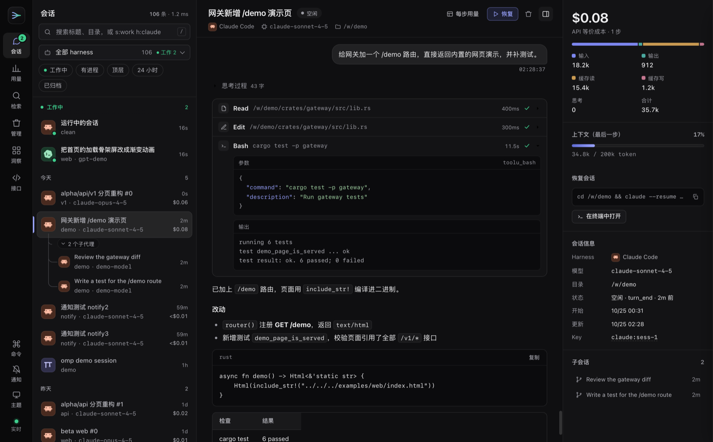
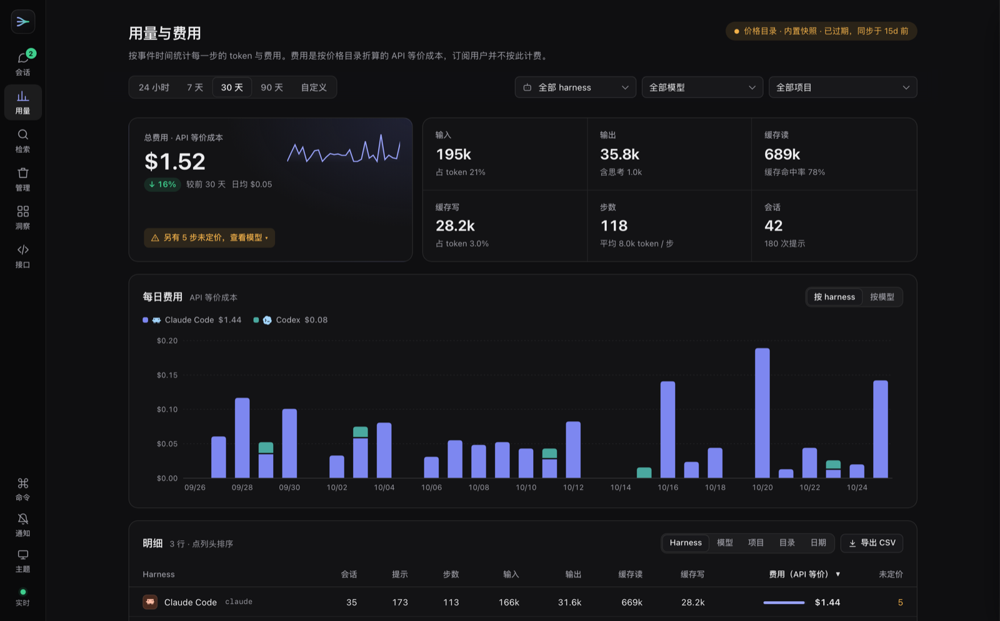
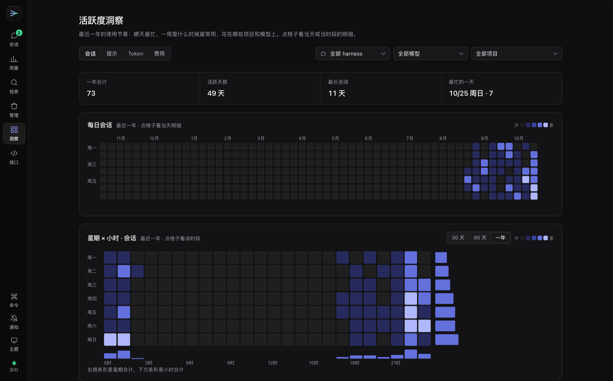
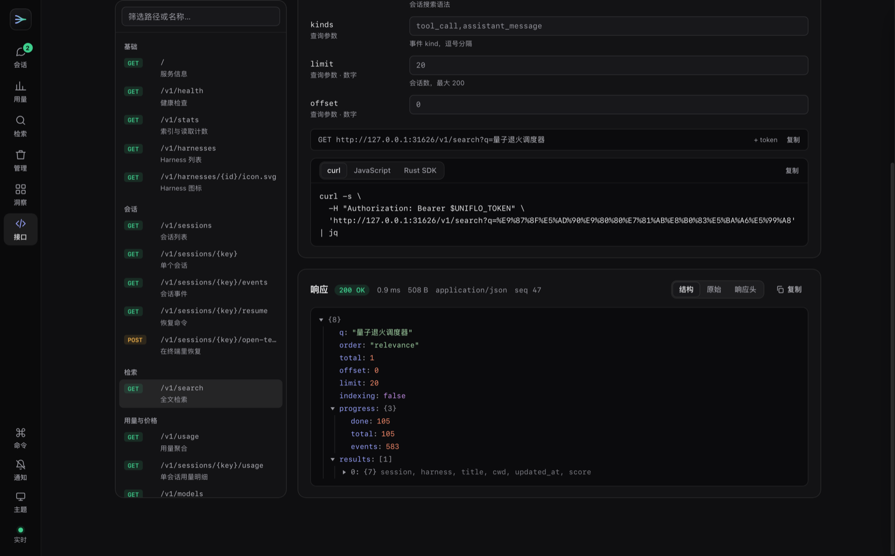
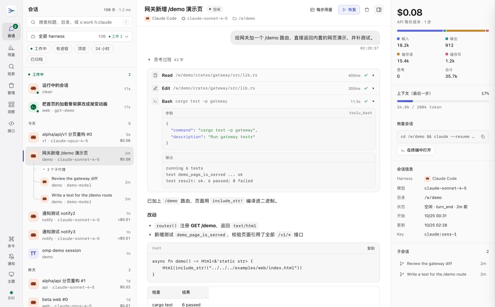

# 网页控制台

> 守护进程在 `/demo` 提供的单文件网页客户端：六个视图、三栏会话页、命令面板、主题与隐私模式；源码 `examples/web/index.html`，无外部运行时依赖、免构建，也可以复制出去改造。

状态：`current` · 更新：2026-10-25

打开：`uniflo daemon` 之后访问 `http://127.0.0.1:7311/demo`。

## 视图

左侧导航栏六个视图（数字键 `1`–`6` 切换，手机宽度变为底部标签栏），视图、过滤、下钻和排序都写进 URL，刷新或分享链接原样恢复：

- **会话**：实时会话流，见下。右侧详情面板显示 API 等价成本、五类 token 及占比、最后一步的上下文占用、恢复命令和会话信息；「每步用量」展开逐步明细；「恢复」复制恢复命令，macOS 上还可直接在 Terminal / iTerm2 / Ghostty 中打开（用 `open` 启动，不需要「自动化」权限；失败时给出原因和可复制的恢复命令）。
- **用量**：24 小时 / 7 / 30 / 90 天或自定义区间，按 harness、模型、项目过滤；KPI（总费用带每日走势、日均和与上一个同长区间的对比）、按 harness 或模型堆叠的每日费用图、可排序明细表（harness / 模型 / 项目 / 目录 / 日期分组，目录可逐级下钻，带面包屑），导出 CSV。费用一律标注「API 等价成本」，未定价的步骤单独计数并可展开到模型列表。
- **检索**：全文检索，结果按会话分组、命中词高亮；点击片段打开会话并滚动到该事件高亮。
- **管理**：勾选会话（整行可点，选中后底部出现批量操作条）→ 生成清理计划（可释放空间、预计归档大小、不可清理的原因）→ 确认执行，逐项显示结果；「归档」页查看与删除归档。守护进程以 `--read-only` 启动时隐藏所有写操作并说明原因。
- **洞察**：最近一年的每日热力图、星期 × 小时分布（可选 30 / 90 天或一年）、项目 / 模型 / harness 前 5 排行，可切换会话 / 提示 / token / 费用指标；按 harness / 模型 / 项目筛选，点排行项也可筛选；点热力图或星期 × 小时的格子弹出当天 / 该时段的明细卡（当天按 harness 等维度的占比和前 3 个会话），方向键切换格子。
- **接口**：守护进程的全部 REST 与实时流接口（`docs/api.md` 里的每一行），选一个接口、填参数、发送，直接看本机的真实返回：状态、耗时、大小、响应头，JSON 按可折叠的结构树展示（时间戳、字节数旁附可读值，大数组分页展开），也可看原始 JSON；SSE / NDJSON / WebSocket 连上后逐条列出 Envelope。每个请求附 curl、JavaScript 与 Rust SDK（`uniflo-client`）写法。会改动数据或打开窗口的写接口只给写法、不发送；生成清理计划只算计划，可以发送。

| 用量与费用 | 活跃度洞察 | 接口 |
|---|---|---|
|  |  |  |

## 会话视图

- 左侧：fd/fzf 式搜索、可搜索的 harness 单选下拉、按「工作中 / 今天 / 昨天 / 最近 7 天 / 更早」分组的会话列表（harness 图标、工作中的脉冲点、子代理、存活进程、费用）。选择新的 harness 会替换原来的正向 `h:` / `harness:` 条件，保留其他查询条件；选「全部 harness」清除该条件。
- 子代理挂在父会话下面：缩进并用连接线连到父会话图标，分支第一行是「N 个子代理 · M 工作中」，点击折叠或展开；子代理多于 4 个时默认只显示工作中的和最近 3 个，其余点「还有 N 个子代理」展开，当前打开的子代理始终可见。一家子按最活跃的成员归组和排序：子代理在工作时，父会话也排进「工作中」。父会话不在列表里（被过滤或超出条数）的子代理单独列出，标「↳ 子代理」。
- 子代理的会话头显示「子代理 · 父会话 <标题>」，点击打开父会话；右侧详情的「子会话」列出它的子代理。
- 中间：归一后的会话流——用户气泡、Markdown 回复（代码块可复制）、折叠的思考、一行一个的工具调用（参数 + 输出 + 耗时 + 状态），按回合汇总 token。
- 右侧：会话详情面板，`]` 或会话头的按钮展开、收起（只动 transform 的滑动动画）。

## 导航栏、命令面板与通知

- 导航栏底部四个按钮都带文字：「命令」打开命令面板，「通知」开关回合结束通知（关闭时图标带斜线），「主题」在跟随系统 / 浅色 / 深色之间切换，「实时」是连接状态；窗口高度不足 760 px 时前三个只显示图标。
- 导航栏底部的连接状态打开「连接与诊断」抽屉：切换 SSE / WebSocket / NDJSON，14 个接口的实时自检与延迟、索引健康度、实时 Envelope 流。
- `⌘K` / `Ctrl+K` 命令面板（视图、操作、会话）；主题可跟随系统或固定浅色、深色；`/` 搜索，`j` `k` 切换会话。
- 回合结束通知（铃铛按钮，默认关闭）：页面在后台时，会话从工作转为空闲会弹系统通知，标题是会话标题，同一会话 30 秒内最多一次，点击通知打开该会话。
- harness 显示单色品牌图标（[lobe-icons](https://github.com/lobehub/lobe-icons)，MIT，加各家官方标识，来源见 `THIRD_PARTY_NOTICES.md`）。没有图标的显示字母块：`crosery`（自家 harness，没有矢量标识）、`prime`（Prime Intellect 官方站点无法取得矢量标识）、`kodu`（仓库为 AGPL-3.0，已停止维护）。

## 布局与 URL 参数

- 响应式布局：宽屏三栏，≤1180px 详情面板改为会话头下方的浮层，≤760px 改为会话列表 / 会话内容单栏切换、导航移到底部；「会话列表」按钮或 `Esc` 返回列表，`/` 打开搜索。通知与工具标题按内容撑高，不遮挡相邻行。
- URL 参数：`?api=http://127.0.0.1:7311`（从其他本地端口打开时）、`?token=`、`?transport=ws`、`?select=<key>`、`?view=<视图>`、`?redact`（模糊所有正文、标题与路径，便于录屏）。

## 依赖与验收

- harness 下拉等选择控件使用 [Tom Select](https://tom-select.js.org/) 2.6.2：脚本、样式及 Apache-2.0 许可证已内嵌，不请求 CDN，也不需要 npm 安装或前端构建。触发器、弹层、选中项和焦点沿用页面主题 token，弹层支持内部滚动及短视口向上展开。
- `scripts/demo-e2e.mjs` 用无头 Chrome 对它做端到端验收（合成数据，不碰真实会话）：三种传输、全部接口、实时追加延迟、work/idle 切换、跨域接入与 token；全部 harness 的图标、用量与 `/v1/usage` 逐项一致、检索跳转、洞察与分组接口一致、通知节流、清理（临时 `UNIFLO_TRASH_DIR`）与只读模式、详情面板滑动、命令面板、诊断抽屉、主题切换、洞察筛选与明细卡、「接口」视图；再按 6 个视图 × 1480 / 390 px × 明暗主题截图，检查横向溢出、元素重叠和 WCAG AA 对比度。打开终端被页面内拦截，不会弹出真实窗口。
- `/demo` 从 `crates/uniflo-gateway/src/index.html` 编译进守护进程；修改演示页时需同步该副本，再重新构建并重启守护进程、刷新浏览器。
- 本页截图（`assets/`）来自 `scripts/demo-e2e.mjs` 的合成数据截图，不含真实会话。
